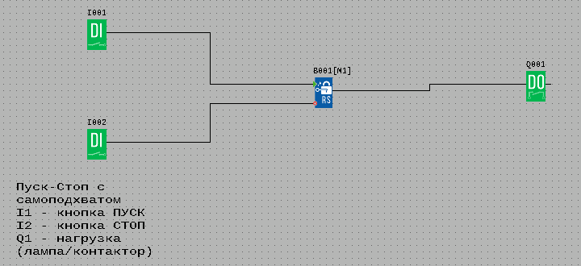
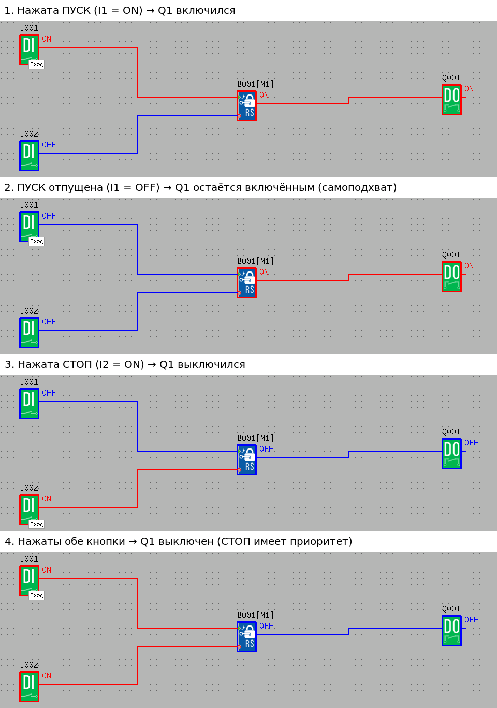

# 01. Пуск-Стоп с самоподхватом

Простая первая программа для программируемого реле ONI PLR: кнопка **ПУСК** включает нагрузку, и она
остаётся включённой после отпускания кнопки; кнопка **СТОП** её выключает.

Файл проекта: [`pusk_stop.xlg`](pusk_stop.xlg) (открывается в ONI PLR Studio: *Файл → Открыть…*).

## Входы и выходы

| Вывод реле | Назначение                           |
|------------|--------------------------------------|
| `I1`       | кнопка ПУСК (нормально открытая)     |
| `I2`       | кнопка СТОП (нормально открытая)     |
| `Q1`       | нагрузка: лампа, контактор и т. п.   |

## Как работает

Схема собрана на одном блоке **RS-триггер** (`B001`, библиотека: *Цифровые → RS триггер*):

- `I1` → вход **S** (установка): короткое нажатие ПУСК переводит триггер в состояние «1»;
- `I2` → вход **R** (сброс): нажатие СТОП переводит триггер в состояние «0»;
- выход триггера → `Q1`.

Триггер «помнит» своё состояние, поэтому кнопку ПУСК не нужно держать. Если обе кнопки нажаты
одновременно, побеждает СТОП (сброс имеет приоритет).

## Проверка в симуляторе

Откройте проект и нажмите **F3** (*Инструменты → Запустить симулятор*). Щелчком по блокам `I001` и
`I002` включаются и выключаются входы. Так программа и была проверена:

> Не путайте с зелёным треугольником ▶ на верхней панели — это **онлайн-монитор**, он работает только
> с подключённым реле. Без реле он выдаёт ошибку `The Commport Open Error!`.

## Загрузка в реле

1. Подключите реле к компьютеру (USB-драйвер `ONI_PLR_USB_DRIVER_WIN_ALL.zip` есть на сайте ONI).
2. *Инструменты → Подключение к PLR…* — выберите порт.
3. *Инструменты → Операции онлайн → Загрузить в PLR*.

Ошибка `The Commport Open Error!` означает, что программа не нашла реле на выбранном порту: проверьте
кабель, драйвер и номер COM-порта (*Диспетчер устройств → Порты (COM и LPT)*).

## Модель реле

Проект создан для **PLR-430-CPU-12D06R-1AC-00** (модель по умолчанию в ONI PLR Studio). Если у вас
другое реле (например, PLR-S или PLR-M), выберите его через *Инструменты → Выбор оборудования…* или
*Файл → Свойства… → Оборудование* — в программе используются только `I1`, `I2` и `Q1`, они есть на
любой модели.

У PLR-430-CPU-12D06R-1AC-00 питание и дискретные входы рассчитаны на ~110–240 В, выходы релейные.
Подключение выполняйте по руководству на ваше реле.

> В реальных установках кнопку СТОП обычно ставят **нормально закрытую** — тогда обрыв провода
> тоже останавливает нагрузку. Для этого сигнал `I2` нужно подать на вход R через блок **НЕ (NOT)**.
