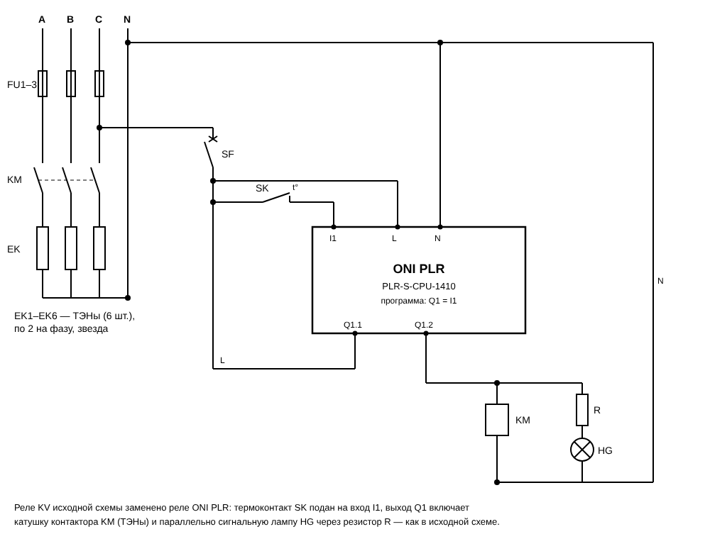
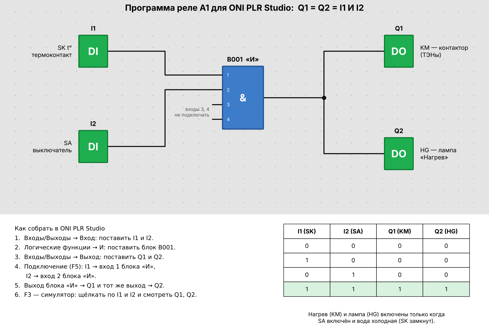
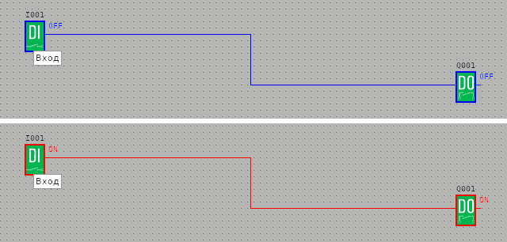

# 02. Емкостной водонагреватель УАП-400/0,9

Схема управления водонагревателем УАП-400/0,9 (рис. 18.1, б) на программируемом реле ONI PLR (`A1`):
термоконтакт **SK** подан на вход `I1`, выключатель **SA** — на вход `I2`. Выход `Q1` включает
контактор **KM** (ТЭНы), выход `Q2` — сигнальную лампу **HG**.

Файл проекта: [`vodonagrevatel.xlg`](vodonagrevatel.xlg) (ONI PLR Studio: *Файл → Открыть…*).

## Принципиальная схема



Исходник схемы — [`principal.svg`](principal.svg), на нём же перечень элементов.

| Обозначение | Назначение                                                         |
|-------------|--------------------------------------------------------------------|
| FU          | предохранители силовой цепи                                        |
| KM          | контактор ТЭНов (силовые контакты и катушка)                       |
| EK          | блок ТЭНов (6 шт.), соединение звездой с нулём N                   |
| SF          | автомат цепи управления (шина L, питание реле A1)                  |
| SK          | термоконтакт (датчик-реле температуры): замкнут, пока вода холодная |
| SA          | выключатель «Нагрев разрешён»                                      |
| R, HG       | добавочный резистор и сигнальная лампа «Нагрев»                     |
| A1          | программируемое реле ONI PLR-S-CPU-1410                            |

## Входы и выходы реле

| Вывод реле     | Подключение                                                     |
|----------------|-----------------------------------------------------------------|
| `L`, `N`       | питание реле: L — после SF, N — нулевая шина                     |
| `I1`           | термоконтакт SK от шины L                                        |
| `I2`           | выключатель SA от шины L                                         |
| `I3`, `I4`     | резерв                                                          |
| `Q1`           | общий контакт — от шины L, выход — на катушку KM                 |
| `Q2`           | общий контакт — от шины L, выход — на резистор R и лампу HG      |

## Программа



Рисунок строит [`draw_program.py`](draw_program.py) (`pip install matplotlib`, затем
`python3 draw_program.py`).

Входы `I1` и `I2` идут на блок **И** (`B001`), его выход — на оба выхода `Q1` и `Q2`:

```
Q1 = I1 · I2      Q2 = Q1
```

- SA включён и вода холодная (SK замкнут) → `Q1` включает KM → ТЭНы греют, `Q2` зажигает HG;
- вода нагрелась (SK разомкнулся) или SA выключен → KM отключён, HG погашена.

Свободные входы 3 и 4 блока **И** в ONI PLR Studio считаются единицей, на результат они не влияют.

## Проверка в симуляторе

Проект собран и проверен в самой ONI PLR Studio (Wine на сервере), во встроенном симуляторе (**F3**)
перебраны все сочетания входов:

| `I1` (SK) | `I2` (SA) | `Q1` (KM) | `Q2` (HG) |
|:---------:|:---------:|:---------:|:---------:|
| 0         | 0         | 0         | 0         |
| 1         | 0         | 0         | 0         |
| 0         | 1         | 0         | 0         |
| 1         | 1         | 1         | 1         |

Оба входа включены — блок **И** и оба выхода включены:



## Как сделан файл

Блоки и связи расставлены в ONI PLR Studio (модель **PLR-S-CPU-1410**, как в проекте
[01_pusk_stop](../01_pusk_stop/)). После этого Studio сохраняет проект байт в байт тем же, то есть
файл в её собственном формате.

Проверка структуры — [`tools/xlg_dump.py`](../../tools/xlg_dump.py):

```
python3 tools/xlg_dump.py programs/02_vodonagrevatel_uap400/vodonagrevatel.xlg
  I001   CInputEntity   id=100    rect=(120..144, 128..166) входы от -
  I002   CInputEntity   id=101    rect=(120..144, 264..302) входы от -
  Q001   COutputEntity  id=12000  rect=(1008..1032, 192..230) входы от [50000]
  Q002   COutputEntity  id=12001  rect=(1008..1032, 328..366) входы от [50000]
  B001   CLogicANDEntity id=100000 rect=(560..584, 192..230) входы от [100, 101]
  линия  I001 -> B001 (вход 0), ...
  линия  I002 -> B001 (вход 1), ...
  линия  B001 -> Q002 (вход 0), ...
  линия  B001 -> Q001 (вход 0), ..., ветвление [(796, 208)]
  итог: ошибок нет
```

> Питание реле и входов на схеме показано для версии ~220 В. Для модели с питанием =24 В подайте на
> `L/N` (`+/−`) и на SK, SA напряжение 24 В от блока питания, а релейные выходы Q1, Q2 так же
> коммутируют катушку KM и лампу HG ~220 В.
