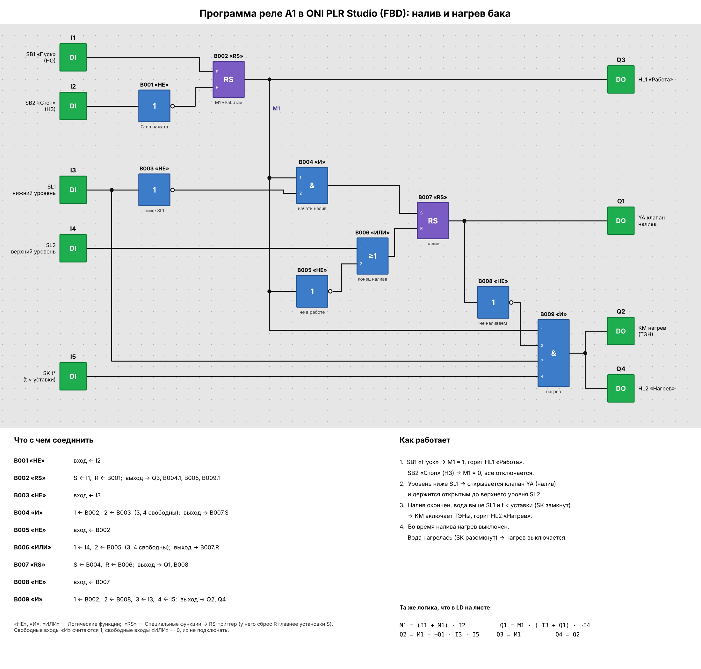

# 03. Бак: налив и нагрев воды (реле A1)

Программа для программируемого реле A1 (ONI PLR) по схеме «бак с клапаном налива YA, датчиками
уровня SL1/SL2, термоконтактом SK и ТЭНами EK». Перенесена из LD-программы на листе в FBD — так
её собирают в ONI PLR Studio.

Файл проекта: [`bak.xlg`](bak.xlg) (ONI PLR Studio: *Файл → Открыть…*, модель PLR-S-CPU-1410).
Собран в самой ONI PLR Studio по рисунку ниже и проверен в её симуляторе.



Рисунок строит [`draw_program.py`](draw_program.py) (`pip install matplotlib`, затем
`python3 draw_program.py`).

## Входы и выходы

| Вывод | Подключение                              | Вывод | Нагрузка                    |
|-------|------------------------------------------|-------|-----------------------------|
| `I1`  | SB1 «Пуск» (НО)                          | `Q1`  | YA — клапан налива          |
| `I2`  | SB2 «Стоп» (НЗ)                          | `Q2`  | KM — контактор ТЭНов        |
| `I3`  | SL1 — нижний уровень                     | `Q3`  | HL1 «Работа»                |
| `I4`  | SL2 — верхний уровень                    | `Q4`  | HL2 «Нагрев»                |
| `I5`  | SK t° — замкнут, пока t < уставки        |       |                             |

## Блоки и связи

| Блок        | Входы                                   | Выход идёт на              |
|-------------|-----------------------------------------|----------------------------|
| B001 «НЕ»   | I2                                      | B002.R                     |
| B002 «RS»   | S ← I1, R ← B001                        | Q3, B004.1, B005, B009.1   |
| B003 «НЕ»   | I3                                      | B004.2                     |
| B004 «И»    | 1 ← B002, 2 ← B003                      | B007.S                     |
| B005 «НЕ»   | B002                                    | B006.2                     |
| B006 «ИЛИ»  | 1 ← I4, 2 ← B005                        | B007.R                     |
| B007 «RS»   | S ← B004, R ← B006                      | Q1, B008                   |
| B008 «НЕ»   | B007                                    | B009.2                     |
| B009 «И»    | 1 ← B002, 2 ← B008, 3 ← I3, 4 ← I5      | Q2, Q4                     |

«НЕ», «И», «ИЛИ» — в группе *Логические функции*, «RS» — RS-триггер (у него сброс главнее
установки). Свободные входы «И» считаются 1, свободные входы «ИЛИ» — 0.

## Как работает

1. SB1 «Пуск» → M1 (B002) = 1, горит HL1 «Работа». SB2 «Стоп» → M1 = 0, всё отключается.
2. Уровень ниже SL1 → открывается клапан YA и держится открытым до верхнего уровня SL2.
3. Налив окончен, вода выше SL1 и t < уставки (SK замкнут) → KM включает ТЭНы, горит HL2.
4. Во время налива нагрев выключен; вода нагрелась (SK разомкнут) → нагрев выключается.

Это та же логика, что в LD на листе:

```
M1 = (I1 + M1) · I2          Q1 = M1 · (¬I3 + Q1) · ¬I4
Q2 = M1 · ¬Q1 · I3 · I5      Q3 = M1          Q4 = Q2
```

## Проверка в симуляторе ONI PLR Studio

| Шаг | Действие                                  | Q1 YA | Q2 KM | Q3 HL1 | Q4 HL2 |
|-----|-------------------------------------------|:-----:|:-----:|:------:|:------:|
| 1   | I2 = 1 (Стоп НЗ не нажата), бак пуст      | 0     | 0     | 0      | 0      |
| 2   | I1 Пуск нажат и отпущен                   | 1     | 0     | 1      | 0      |
| 3   | I3 = 1 (вода выше SL1)                    | 1     | 0     | 1      | 0      |
| 4   | I4 = 1 (достигнут SL2)                    | 0     | 0     | 1      | 0      |
| 5   | I5 = 1 (вода холодная)                    | 0     | 1     | 1      | 1      |
| 6   | I5 = 0 (нагрелась), затем снова 1         | 0     | 0 → 1 | 1      | 0 → 1  |
| 7   | I4 = 0 (уровень ниже SL2)                 | 0     | 1     | 1      | 1      |
| 8   | I3 = 0 (ниже SL1) — снова налив           | 1     | 0     | 1      | 0      |
| 9   | I2 = 0 (Стоп), затем отпущен              | 0     | 0     | 0      | 0      |

Совпадение FBD и LD проверено перебором на Python: 20 000 случайных последовательностей нажатий
по 30 шагов, выходы совпали на каждом шаге.
