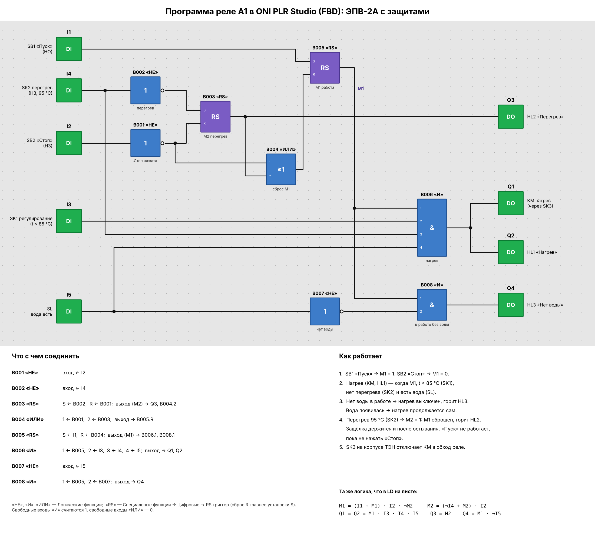

# 04. ЭПВ-2А: защита от перегрева и от работы без воды (реле A1)

Файл проекта: [`epv2a.xlg`](epv2a.xlg) (ONI PLR Studio: *Файл → Открыть…*, модель PLR-S-CPU-1410).
Собран в ONI PLR Studio по рисунку ниже и проверен в её симуляторе.



Рисунок строит [`draw_program.py`](draw_program.py) (`pip install matplotlib`, затем
`python3 draw_program.py`).

## Входы и выходы

| Вывод | Подключение                                   | Вывод | Нагрузка                       |
|-------|-----------------------------------------------|-------|--------------------------------|
| `I1`  | SB1 «Пуск» (НО)                               | `Q1`  | KM — нагрев (через SK3)        |
| `I2`  | SB2 «Стоп» (НЗ)                               | `Q2`  | HL1 «Нагрев»                   |
| `I3`  | SK1 — регулирование, замкнут при t < 85 °C    | `Q3`  | HL2 «Перегрев»                 |
| `I4`  | SK2 — перегрев (НЗ), размыкается при 95 °C    | `Q4`  | HL3 «Нет воды»                 |
| `I5`  | SL — есть вода в трубопроводе                 |       |                                |

## Логика

Та же, что в LD на листе:

```
M1 = (I1 + M1) · I2 · ¬M2     M2 = (¬I4 + M2) · I2
Q1 = Q2 = M1 · I3 · I4 · I5   Q3 = M2     Q4 = M1 · ¬I5
```

M1 — RS-триггер B005 (Пуск/Стоп), M2 — RS-триггер B003 (защёлка перегрева). Совпадение с LD
проверено перебором на Python: 20 000 случайных последовательностей, расхождений нет.

## Проверка в симуляторе ONI PLR Studio

| Шаг | Действие                                         | Q1 KM | Q2 HL1 | Q3 HL2 | Q4 HL3 |
|-----|--------------------------------------------------|:-----:|:------:|:------:|:------:|
| 1   | Стоп (НЗ) и SK2 (НЗ) в норме, вода есть, холодно | 0     | 0      | 0      | 0      |
| 2   | Пуск                                             | 1     | 1      | 0      | 0      |
| 3   | SK1 разомкнулся (85 °C), затем снова замкнулся   | 0 → 1 | 0 → 1  | 0      | 0      |
| 4   | Нет воды (SL = 0), затем вода появилась          | 0 → 1 | 0 → 1  | 0      | 1 → 0  |
| 5   | Перегрев (SK2 = 0), затем остыл                  | 0     | 0      | 1      | 0      |
| 6   | Пуск при защёлке перегрева                       | 0     | 0      | 1      | 0      |
| 7   | Стоп (сброс), затем Пуск                         | 1     | 1      | 0      | 0      |
| 8   | Стоп                                             | 0     | 0      | 0      | 0      |
