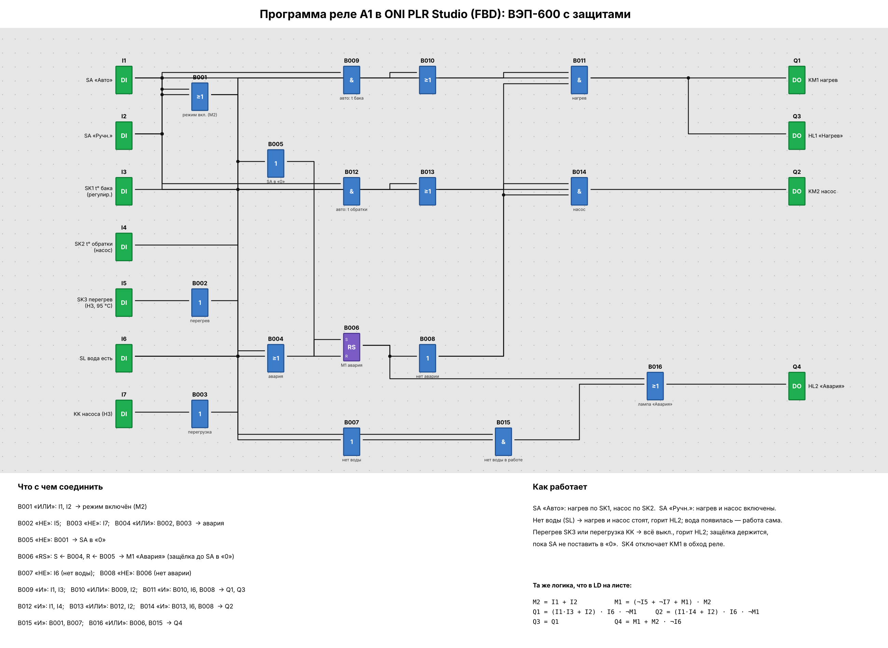

# 05. ВЭП-600: защиты от перегрева, работы без воды и перегрузки насоса (реле A1)

Файл проекта: [`vep600.xlg`](vep600.xlg) (ONI PLR Studio: *Файл → Открыть…*, модель PLR-S-CPU-1410).
Собран в ONI PLR Studio и проверен в её симуляторе.



Рисунок строится прямо из `vep600.xlg` скриптом [`draw_program.py`](draw_program.py)
(`pip install matplotlib`, затем `python3 draw_program.py`).

## Входы и выходы

| Вывод | Подключение                                  | Вывод | Нагрузка              |
|-------|----------------------------------------------|-------|-----------------------|
| `I1`  | SA «Авто»                                    | `Q1`  | KM1 — нагрев (через SK4) |
| `I2`  | SA «Ручн.»                                   | `Q2`  | KM2 — насос           |
| `I3`  | SK1 — t воды в баке (регулирование нагрева)  | `Q3`  | HL1 «Нагрев»          |
| `I4`  | SK2 — t обратной воды (включение насоса)     | `Q4`  | HL2 «Авария»          |
| `I5`  | SK3 — перегрев (НЗ, 95 °C)                   |       |                       |
| `I6`  | SL — есть вода в трубопроводе                |       |                       |
| `I7`  | KK — тепловое реле насоса (НЗ)               |       |                       |

## Логика

Та же, что в LD на листе (M1 — RS-триггер B006 «Авария», M2 — B001 «режим включён»):

```
M2 = I1 + I2                  M1 = (¬I5 + ¬I7 + M1) · M2
Q1 = (I1·I3 + I2) · I6 · ¬M1  Q2 = (I1·I4 + I2) · I6 · ¬M1
Q3 = Q1                       Q4 = M1 + M2 · ¬I6
```

Совпадение с LD проверено перебором на Python (20 000 случайных последовательностей, расхождений нет).

## Проверка в симуляторе ONI PLR Studio

| Шаг | Действие                                      | Q1 KM1 | Q2 KM2 | Q3 HL1 | Q4 HL2 |
|-----|-----------------------------------------------|:------:|:------:|:------:|:------:|
| 1   | SA в «0», защиты в норме, вода есть           | 0      | 0      | 0      | 0      |
| 2   | SA «Авто», SK1 и SK2 разомкнуты               | 0      | 0      | 0      | 0      |
| 3   | SK1 замкнулся / SK2 замкнулся                 | 1      | 0 → 1  | 1      | 0      |
| 4   | Нет воды, затем вода появилась                | 0 → 1  | 0 → 1  | 0 → 1  | 1 → 0  |
| 5   | Перегрев SK3, затем остыл                     | 0      | 0      | 0      | 1      |
| 6   | SA в «0» (сброс аварии)                       | 0      | 0      | 0      | 0      |
| 7   | SA «Ручн.»                                    | 1      | 1      | 1      | 0      |
| 8   | Перегрузка KK, затем возврат KK               | 0      | 0      | 0      | 1      |
| 9   | SA в «0»                                      | 0      | 0      | 0      | 0      |
