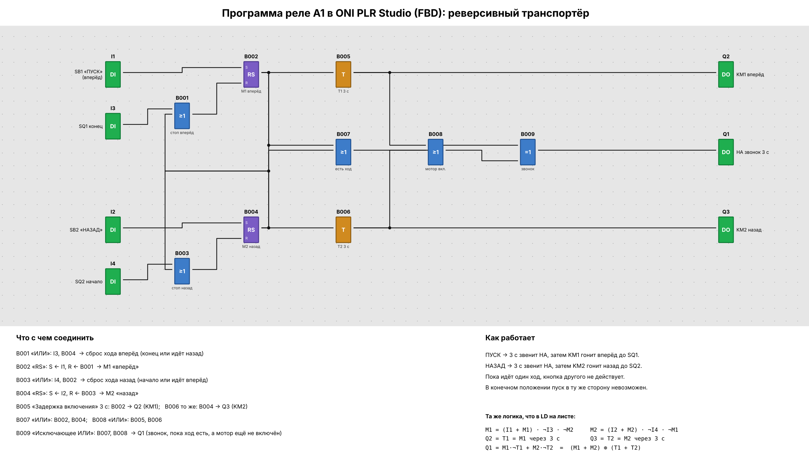

# 06. Реверсивный транспортёр (реле A1)

Файл проекта: [`transporter.xlg`](transporter.xlg) (ONI PLR Studio: *Файл → Открыть…*, модель PLR-S-CPU-1410).
Собран в ONI PLR Studio и проверен в её симуляторе.

Рисунок строится прямо из `transporter.xlg` скриптом [`draw_program.py`](draw_program.py)
(`pip install matplotlib`, затем `python3 draw_program.py`).

## Входы и выходы

| Вывод | Подключение            | Вывод | Нагрузка                    |
|-------|------------------------|-------|-----------------------------|
| `I1`  | SB1 «ПУСК» (вперёд)    | `Q1`  | HA — звонок 3 с перед пуском |
| `I2`  | SB2 «НАЗАД»            | `Q2`  | KM1 — вперёд                |
| `I3`  | SQ1 — конец            | `Q3`  | KM2 — назад                 |
| `I4`  | SQ2 — начало           |       |                             |

## Программа (упрощённая)

9 блоков вместо 7 ступеней LD с флагами и двумя таймерами-катушками:

| Блок                         | Входы               | Выход идёт на           |
|------------------------------|---------------------|-------------------------|
| B001 «ИЛИ»                   | I3, B004            | B002.R                  |
| B002 «RS» — M1 «вперёд»      | S ← I1, R ← B001    | B003, B005, B007        |
| B003 «ИЛИ»                   | I4, B002            | B004.R                  |
| B004 «RS» — M2 «назад»       | S ← I2, R ← B003    | B001, B006, B007        |
| B005 «Задержка включения» 3 с | B002               | Q2, B008                |
| B006 «Задержка включения» 3 с | B004               | Q3, B008                |
| B007 «ИЛИ»                   | B002, B004          | B009                    |
| B008 «ИЛИ»                   | B005, B006          | B009                    |
| B009 «Исключающее ИЛИ»       | B007, B008          | Q1                      |

Звонок звенит, пока ход уже задан, а мотор ещё не включён: `Q1 = (M1 + M2) ⊕ (T1 + T2)`.
Это то же самое, что `M1·¬T1 + M2·¬T2` в LD на листе. Совпадение с LD проверено перебором на Python
(20 000 случайных последовательностей нажатий, расхождений нет).

## Проверка в симуляторе ONI PLR Studio

| Шаг | Действие                              | Q1 звонок | Q2 KM1 | Q3 KM2 |
|-----|---------------------------------------|:---------:|:------:|:------:|
| 1   | ПУСК                                  | 1         | 0      | 0      |
| 2   | через 3 с                             | 0         | 1      | 0      |
| 3   | НАЗАД во время хода вперёд            | 0         | 1      | 0      |
| 4   | SQ1 (конец)                           | 0         | 0      | 0      |
| 5   | НАЗАД                                 | 1         | 0      | 0      |
| 6   | через 3 с                             | 0         | 0      | 1      |
| 7   | ПУСК во время хода назад              | 0         | 0      | 1      |
| 8   | SQ2 (начало)                          | 0         | 0      | 0      |
| 9   | НАЗАД при нажатом SQ2 / ПУСК при SQ1  | 0         | 0      | 0      |
